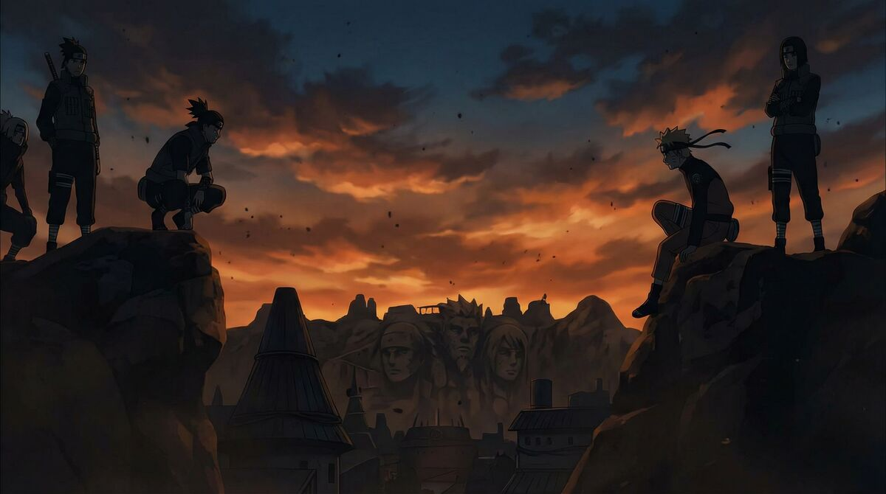

# Naruto & Boruto Guide



Interactive viewing guide for Naruto (720 episodes, 11 films, 13 OVAs) and Boruto: Naruto Next Generations (293 episodes). The Naruto route follows the [guide by Даинг Окаянный](https://shikimori.io/articles/365-naruto-ultimativnyy-gayd-po-prosmotru) on Shikimori. Boruto arc boundaries follow the [official episode catalog](https://naruto-official.com/en/anime/boruto/list). Its watch-mode markers are editorial. Boruto broadcast years use the [TVmaze episode list](https://www.tvmaze.com/shows/23796/boruto-naruto-next-generations/episodes).

## Features

- Series switcher (Naruto / Boruto) on a single page
- 5 viewing modes per series (Speedrun → На выживание)
- Color-coded episode markers (story, filler tiers, recaps, novels)
- Per-episode and plot-scene progress, a resume button, and shareable URLs
- Arc grouping with timeline, ratings, and manga chapter references
- Spoiler blur toggle, search, PWA install support

## Stack

React, TypeScript, Vite, Tailwind CSS, Framer Motion

## Development

```
pnpm install
pnpm dev
```

## Build

```
pnpm build
```

Output goes to `dist/`. Configured for GitHub Pages with custom domain via `CNAME`.

## Contributing: data edits and new seasons

All series data lives in `client/src/lib/series/`. Each series has its own file (`naruto.ts`, `boruto.ts`) exporting a `SeriesConfig` object that bundles episodes, arcs, watch modes, and metadata.

### Editing episodes

Episodes are in the `EPISODES` array. Each entry groups consecutive episodes of the same type:

```ts
{ id: 14, marker: 'С', episodes: 'Серии 53-66', title: 'Арка Экзамена Чунина', type: 'series', season: 1, releaseDate: '2018', note: 'Манга-адаптация' },
```

- `id` — unique catalog row ID within the series
- `marker` — classification: `С` (canon), `Ф1`–`Ф4` (filler quality tiers), `ФН` (novel), `П` (recap), or mixed like `С+Ф1`
- `episodes` — display string: `Серии X-Y`, `Серия X`, `ФИЛЬМ X`, or `ОВА X`
- `type` — `'series'`, `'film'`, or `'ova'`
- `season` — numeric (1, 2, etc.)
- `releaseDate` — year string like `'2023'`
- `note` — optional, explains mixed-marker entries or context

### Adding a new season (e.g. Boruto: Two Blue Vortex)

1. Add new episodes to the `EPISODES` array with the next sequential `id` values and `season: 2`
2. Add new arcs to the `ARCS` array referencing the new episode IDs
3. Add a season entry: `{ id: 2, name: 'Two Blue Vortex', subtitle: 'Серии 1–...', image: '/images/boruto-season2.jpg' }`
4. Extend the catalog coverage test and run `pnpm test`, `pnpm check` and `pnpm build`.
5. Add images to `client/public/images/` (optimize to ≤300KB for heroes, ≤100KB for arcs)

### Adding a new series

1. Create `client/src/lib/series/newseries.ts` following the pattern of `naruto.ts` or `boruto.ts`
2. Add the series ID to the `SeriesId` type in `series-config.ts`
3. Register it in `series-registry.ts`
4. Add it to `SERIES_LIST` in `series-config.ts`
5. Add an empty legacy row list for the series in `legacy-progress.ts`.
6. Add hero/arc images to `client/public/images/`

### Watch modes

The ordered catalog determines placement. Each source row belongs to one arc. In Naruto, the optional companion episode 271 follows film 9 when the route includes both. Each mode derives its visible rows, totals, and progress from the same route.

Use `parts.base` for the default classification within a mixed row. Override specific numbers with `story` (whole story episode), `filler` (whole filler), `scenes` (filler containing plot scenes), or `inserts` (story with filler inserts). The filler tier comes from the source marker. Pure filler rows can still have a required plot scene. Runtime estimates cover full items only. The guide does not supply timestamps for most plot scenes.

Progress keys combine the season, item type and broadcast number within each series. Full episodes also satisfy their plot scenes. Old local saves and unversioned share links expand through the frozen row map in `legacy-progress.ts`. Keep that map unchanged when editing the catalog. The first edit to an old save writes the v2 record.

### Reviewing upstream changes

The Naruto snapshot was checked on 2026-11-03 against the article marked 2026-07-18. It records 175 source ranges, markers and wording hashes. The command below compares the article body without comments or page metadata. A changed snapshot needs editorial review of the relevant route, notes and mode rules.

```sh
python3 scripts/check_source.py
# Review the reported changes, edit the catalog, then accept the new snapshot.
python3 scripts/check_source.py --update
pnpm test
```

Pass `--file article.html` to reproduce a comparison offline. Pull-request checks use the committed snapshot and do not fetch external sites.

### Images

Place images in `client/public/images/`. Target sizes:
- Hero backgrounds: 1920px wide, quality 80 (~250KB)
- Season headers: 1280px wide, quality 75 (~150KB)
- Arc backgrounds: 800px wide, quality 75 (~50-100KB)
